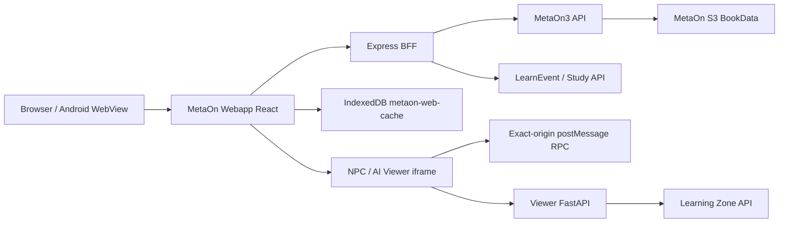

# MetaOn Webapp Project Context

> 기준일: 2026-07-15 KST
> 주 소스: `D:\Codex\MetaOn\webapp`
> 연동 소스: `D:\Codex\metaonlivechat`
> 상세 인계·실행·배포 절차: [CODEX_HANDOFF.md](CODEX_HANDOFF.md)

## 1. 프로젝트 정체성

MetaOn은 Unity 기반 영어학습 앱을 웹 네이티브로 재구현하는 프로젝트다. 학습자는 Web 또는 Android WebView에서 로그인하고, 브랜드/Grade/Level/Book을 선택한 뒤 S3 리소스를 IndexedDB에 저장하여 Word, Sentence, Reading, Listen & Read, Quick Check 등의 Activity를 실행한다.

웹 구현의 원칙은 다음과 같다.

- Unity 화면과 학습 흐름을 최대한 유지하되, 브라우저 기능으로 대체한다.
- 기존 upstream API와 S3는 BFF와 IndexedDB를 경유해 웹 환경 제약을 흡수한다.
- `ActType`은 Unity 호환성 기준으로 유지하지만, 실제 renderer 선택은 신규 문자열 `activity_code`를 우선한다.
- 학습행동은 `learn_event`로 축적하고, 이후 개인화와 추천의 근거로 사용한다.

## 2. 현재 운영 상태

| 서비스 | 역할 | GCP 프로젝트 | 현재 리비전 | 운영 URL |
|---|---|---|---|---|
| `metaon-webapp` | React SPA + Express BFF + Book/Activity | `gen-lang-client-0309121556` | `metaon-webapp-00076-j6s` | `https://metaon-webapp-geaypbs2uq-du.a.run.app` |
| `metaon-web` | AI Speaking + NPC Activity Viewer | `meta-on-project-230224` | `metaon-web-00126-ngs` | `https://metaon-web-qvfybxizya-du.a.run.app` |

두 Cloud Run 서비스는 서로 다른 GCP 프로젝트에서 운영된다. 메인 Webapp의 iframe URL은 `metaon-web`을 향한다. 한쪽 서비스를 다른 폴더에서 배포하지 않는다.

## 3. 전체 구조



### 데이터 흐름

1. 로그인은 Webapp BFF가 upstream session을 검증하고 HttpOnly cookie로 보관한다.
2. `/api/books`와 Book resource manifest가 MetaOn3 API 응답을 화면용 모델로 정규화한다.
3. Browser가 S3 리소스를 직접 다운로드하고 IndexedDB의 package/file Blob으로 저장한다.
4. `ActivityPage`가 study start/end, fullscreen, renderer context, LearnEvent flush를 통합한다.
5. 일반 Activity는 cached Book package를 읽는다.
6. AI Speaking, Metaverse, NPC Quick Check는 iframe을 열고 HMAC launch token과 RPC를 사용한다.

## 4. 구현 완료 범위

### 플랫폼과 화면

- 실제 MetaOn3 로그인 및 catalog/Book 데이터 연결
- Home, Study Zone, 브랜드/Grade/Level sidebar, Book 상세, Activity cube map
- 모바일 Study Zone drawer, Home/Placement/프로필/알림/기관 화면
- AI Speaking과 메타버스 fullscreen iframe 진입·복귀 흐름
- Placement Test UI와 추천된 Study Zone route 연결

### 리소스와 학습 실행

- 기존 ZIP 중심 방식 대신 MetaOn S3 resource manifest + IndexedDB cache 사용
- Book 진입 시 resource 자동 다운로드와 진행률 UI
- E-book canonical resource 탐색과 Listen & Read fallback
- Word Card, Word Quiz, Word Blank, Matching, Memory, Sentence Blank, Unscramble, Sentence Record, Reading, Listening, Quick Check 등 주요 renderer
- 공통 Back, Check, Prev/Next, Hint, Timer, Listen 이미지 controls
- Activity 1280x720 전체 화면 우선 레이아웃과 콘텐츠 간섭 최소화

### 학습 결과와 개인화 기반

- `learn_event` recorder와 Activity 완료 시 flush 흐름
- word/sentence `item_idx`를 PK 기준으로 기록하는 mastery event
- Home에 이어서 학습, 오늘의 맞춤 학습, 추천 학습 UI 미리보기
- 실제 mastery 집계/추천 서버는 아직 미연동

### Quick Check와 NPC

- `QCHK01`: 기존 Quick Check 화면과 Unity 호환 채점 adapter
- `NPCQHK01`: Book의 cached `npcqhk/script.json`과 audio를 사용하는 NPC 대화형 Activity
- `QCNP01`: 과거 code 호환 alias
- iframe은 정답이 제거된 질문만 받고 Parent Webapp이 채점·LearnEvent·완료를 처리
- NPC Viewer는 자동 음성, 선택 즉시 제출, 정답/오답 분기, 결과 화면을 제공
- Jade NPC 입은 본체 TALK Lottie와 전용 mouth Lottie viseme animation을 함께 사용한다.

## 5. Activity code 기준

| Activity | 현재 code | 공통 ActType | 데이터 원천 |
|---|---:|---:|---|
| Listen & Read | `EBOOK01` | Listening/Reading | `ebook/book.json`, page/audio assets |
| Word Card | `WDCA01` | FlashCard | Book word assets |
| Word Quiz | `WDQU01` | VocaQuiz | Book word assets |
| Word Blank | `WDBL01` | VocaCheck | Book word assets |
| Matching Game | `WDPL01` | MatchingGame | Book word assets |
| Memory Card | `WDPL02` | MemoryGame | Book word assets |
| Sentence Blank | `STBL01` | SentenceCheck | Book sentence + word assets |
| Unscramble | `STSC01` | SentenceUnscramble | Book sentence assets |
| Sentence Record | `STRC01` | SentenceShadowing | Book sentence/audio assets |
| Quick Check | `QCHK01` | QuickCheck | Study Quick Check API |
| NPC Quick Check | `NPCQHK01` | QuickCheck | cached `npcqhk` script/audio |
| Legacy NPC Quick Check | `QCNP01` | QuickCheck | legacy compatibility |
| Planned personalized NPC | `NPCQHK02` | QuickCheck | 사용자별 word/sentence session API |

`activity_code` mapping은 `src/services/activityCodes.ts`, renderer 분기는 `src/services/activityRegistry.tsx`가 기준이다.

## 6. 중요 모듈

| 영역 | 기준 파일 | 책임 |
|---|---|---|
| Activity lifecycle | `src/pages/ActivityPage.tsx` | study log, fullscreen, Activity navigation, LearnEvent flush |
| Activity renderer | `src/services/activityRegistry.tsx` | code/ActType에 맞는 renderer 선택 |
| Activity code | `src/services/activityCodes.ts` | Unity ActType과 문자열 code 정규화 |
| Activity 구현 | `src/components/activities/PackageActivities.tsx` | 다수 Word/Sentence/Reading renderer |
| MetaOn3 adapter | `src/services/metaon3ResourceAdapter.ts` | API -> manifest/lesson/day/activity/resource 변환 |
| resource cache | `src/services/bookPackageImporter.ts` | S3 다운로드, generated files, package 저장 |
| IndexedDB | `src/services/indexedDbStorage.ts` | `metaon-web-cache` Blob package/file store |
| Quick Check | `src/features/quickCheck/` | DTO, adapter, renderer, tests |
| NPC Parent host | `src/features/npcQuickCheck/NpcQuickCheckActivity.tsx` | Viewer RPC, scoring, LearnEvent, completion |
| NPC Book adapter | `src/features/npcQuickCheck/npcQuickCheckResourceAdapter.ts` | `npcqhk/script.json` -> sanitized Viewer bootstrap |
| Main BFF | `server/index.mjs` | auth, catalog, resource, study, LearnEvent, iframe routes |
| NPC token | `server/npcQuickCheckLaunch.mjs` | HMAC launch/verify |
| shared scoring | `shared/quickCheckScoring.mjs` | Quick Check canonical scoring |
| NPC Viewer UI | `D:\Codex\metaonlivechat\src\components\npcQuickCheck\NpcQuickCheckViewer.jsx` | NPC UI/audio/branching/lipsync |
| Viewer backend | `D:\Codex\metaonlivechat\backend\main.py` | Viewer context and AI backend routes |

## 7. 현재 설계 경계

### Browser와 BFF

Browser는 upstream MetaOn API session을 직접 보유하지 않는다. Express BFF가 session header/cookie, CORS, API normalization을 담당한다. `METAON_AUTH_COOKIE_SECRET`은 Cloud Run revision을 넘어서 안정적으로 유지되어야 한다.

### S3와 IndexedDB

S3 URL은 browser에서 직접 fetch한다. Book resource는 package key와 virtual path로 IndexedDB에 저장되며, renderer는 network가 아니라 cached Blob을 우선 읽는다. 리소스 구조를 바꾸면 manifest, importer, renderer context를 같이 수정해야 한다.

### iframe 보안

NPC Viewer는 Parent의 `contentWindow`와 exact origin을 검증한다. HMAC token은 URL query가 아닌 bootstrap/context 요청에서 사용한다. 정답, MetaOn auth cookie, upstream session ID는 Viewer로 넘기지 않는다.

### 개인화

현재 개인화는 UI와 LearnEvent 수집 기반이다. 개인화 결과로 실제 Activity를 구성하는 기능은 아직 없다. `NPCQHK02`부터는 서버가 사용자별 `session_id` snapshot을 만들고, 단어/문장 선택·정답·피드백을 세션 단위로 고정해야 한다.

## 8. 알려진 미완료·리스크

1. `NPCQHK02`는 계획만 있고 code, API, renderer가 아직 없다.
2. LearnEvent를 mastery/skill/recommendation으로 파생하는 서버 데이터 파이프라인이 필요하다.
3. Quick Check와 Placement의 일부 in-memory session은 Cloud Run scale-out에서 안전하지 않다. Redis/DB로 옮겨야 한다.
4. 모든 Unity Activity가 동등하게 web porting된 상태는 아니다. 신규 code는 renderer, asset adapter, LearnEvent, 테스트 단위로 추가한다.
5. Android WebView에서 microphone, IndexedDB quota, S3 media, 외부 iframe의 완전한 E2E 검증이 계속 필요하다.
6. `implementation_0701.md`, `implementation_0710.md`, `implementation_0713.md`에는 역사적 설계가 섞여 있다. 특히 NPC Quick Check는 현재 소스가 최종 기준이다.

## 9. 로컬 개발·검증

### Main Webapp

```powershell
Set-Location D:\Codex\MetaOn\webapp
npm ci
Copy-Item .env.example .env.local
npm run dev
npm test
npm run build
```

- SPA: `http://127.0.0.1:5173`
- Express BFF: `http://127.0.0.1:4100`

### NPC Viewer

```powershell
Set-Location D:\Codex\metaonlivechat
npm ci
npm run dev:test -- --port 5174
npm test
npm run build:test
```

- Sample: `http://127.0.0.1:5174/?mode=npc-quick-check&sample=G1LG11`
- Alternate sample: `sample=GPLB64`

## 10. 배포 기준

메인 Webapp:

```powershell
Set-Location D:\Codex\MetaOn\webapp
npm test
npm run build
gcloud run deploy metaon-webapp --source . --region asia-northeast3 --project gen-lang-client-0309121556 --clear-base-image --quiet
```

NPC/AI Viewer:

```powershell
Set-Location D:\Codex\metaonlivechat
npm test
npm run build:test
gcloud run deploy metaon-web --source . --region asia-northeast3 --project meta-on-project-230224 --clear-base-image --quiet
```

배포 후에는 revision/traffic, 메인 `/api/health`, 로그인, Book download, Activity 실행을 확인한다.

## 11. 다음 작업 우선순위

1. Learning Zone과 `NPCQHK02` 개인화 세션 API 계약 확정
2. `NPCQHK02`를 기존 NPC Parent/Viewer를 재사용하는 전용 renderer로 구현
3. 개인화 session media를 IndexedDB 공통 cache로 저장
4. LearnEvent 기반 mastery/skill 집계와 Home 추천 API 연결
5. Quick Check/Placement/NPC session을 Redis 또는 DB로 전환
6. Android WebView 전체 E2E와 잔여 Unity Activity renderer 품질 검증

## 12. 작업 규칙

- `D:\Codex\MetaOn` 상위 Unity 저장소에는 unrelated dirty change가 있을 수 있다. `git add .`, hard reset, broad revert를 사용하지 않는다.
- `D:\Codex\metaonlivechat\backend`의 `.env`, credential, service-account 파일을 Git/문서/대화에 노출하지 않는다.
- 배포 전에는 반드시 해당 폴더에서 test와 build를 수행한다.
- 새 Activity는 `activity_code` -> renderer -> resource/API adapter -> LearnEvent -> test -> deployment 순서로 변경 범위를 닫는다.
