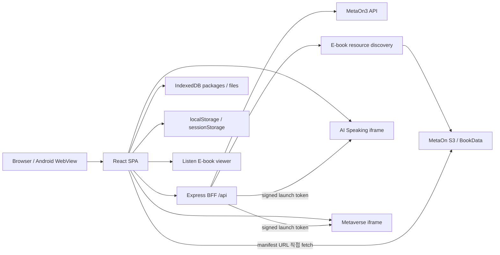
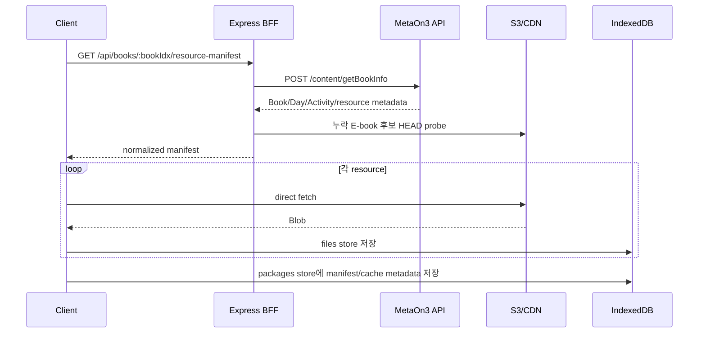

# MetaOn Webapp 구현 현황

> 기준 시각: 2026-07-10 09:31 KST  
> 대상 경로: `D:\Codex\MetaOn\webapp`  
> 운영 서비스: `metaon-webapp` / Cloud Run `asia-northeast3`  
> 문서 성격: 2026-07-10 현재 소스, 로컬 검증 결과, 운영 배포 상태를 함께 정리한 인계 문서

## 1. 문서 범위와 기준

이 문서는 **MetaOn Webapp만을 별도로** 정리한다. `D:\Codex\Uniplayer-RazKids`의 UniPlanet 문서와 `D:\Codex\metaon-e-book-creator` 프로젝트는 범위에 포함하지 않는다.

MetaOn Webapp은 UniPlanet 구현을 출발점으로 삼았지만, 현재는 MetaOn3 API, MetaOn S3 리소스, MetaOn 인증 세션, AI Speaking, Metaverse, Raz Placement 흐름을 결합한 별도 애플리케이션이다.

현재 `webapp/` 전체는 상위 Unity 저장소 `D:\Codex\MetaOn`에서 Git 미추적 상태다. 따라서 이 문서는 Git 커밋 비교 문서가 아니라 다음 근거를 우선해 작성했다.

1. 2026-07-10 09:31 KST 시점의 실제 소스
2. `implementation_0701.md` 및 기능별 설계·인계 문서
3. 로컬 빌드·테스트·프로덕션 모드 smoke test 결과
4. 현재 Cloud Run 서비스와 Cloud Build 조회 결과

조사 도중 09:23~09:24 KST에 E-book 리소스 탐색 관련 소스가 추가 갱신되었다. 본 문서는 해당 변경이 안정된 뒤 다시 읽고 검증한 **09:31 KST 스냅샷**을 기준으로 한다.

## 2. 한눈에 보는 현재 상태

| 구분 | 현재 상태 |
|---|---|
| 프론트엔드 | React 18 + TypeScript + Vite 8 + React Router 6 |
| BFF/런타임 | Express 4 + Node.js 22, SPA 정적 파일과 `/api`를 단일 서버에서 제공 |
| 주요 화면 | 홈, 로그인, Study Zone, Book 상세, Activity, Placement, AI, Metaverse, Profile/Progress/기관 화면 |
| 사용자 URL 패턴 | `/` 포함 25개 |
| Catalog | MetaOn3 `/content/getMyBrands`, 실패 시 sample catalog fallback |
| Book 리소스 | `/content/getBookInfo` → 정규화 manifest → S3 직접 다운로드 → IndexedDB |
| ZIP package | 폐기됨. 관련 API는 `410 Gone` |
| Activity 체계 | Unity `ActType` 91개 인식: 전용 구현 40, 호환 renderer 16, planned 21, web replacement 14 |
| E-book | canonical `ebook/book.json` 기반 viewer 우선, React viewer/MP4 fallback |
| 학습 로그 | study start/end + LearnEvent 메모리 수집·완료 시 전송 + 녹음 업로드 |
| Placement | 8개 고정 지문 기반 프로토타입, 한 세션 최대 3단계, 서버 메모리 저장 |
| AI/Metaverse | 외부 iframe + HMAC launch token + `postMessage` RPC |
| 로컬 검증 | 루트 build 성공, 16 test files / 89 tests 성공, placement 하위 앱 build 성공 |
| 운영 배포 | Cloud Run revision `metaon-webapp-00053-tg4`, traffic 100% |
| 중요 차이 | 09:23 이후 최신 E-book discovery 소스는 현재 운영 revision보다 새로움 |

## 3. 2026-07-01 문서 이후의 주요 변화

`implementation_0701.md`에 기록된 MetaOn3 catalog/resource 전환과 IndexedDB 기반 Activity 실행은 유지되며, 그 이후 다음 영역이 크게 확장됐다.

- Listen & Read용 E-book viewer, 자막·단어 하이라이트, page/audio navigation
- Activity prototype 5종 화면
- 홈 개인화 카드 및 7종 hero theme
- Raz Placement 소개·테스트·결과·Study Zone 추천 연결
- LearnEvent 수집 및 녹음 업로드 경로
- AI Speaking·Metaverse fullscreen iframe와 RPC
- Study Zone grade/level sidebar와 모바일 drawer
- 신규 문자열 Activity code 정규화
- Listen E-book의 누락된 `ebook/book.json` 탐색 및 하위 page/audio 자산 확장 다운로드
- Activity 상단 메뉴 자동 숨김과 viewer navigation 개선
- Cloud Run revision `00016`에서 `00053`까지의 후속 배포

단, 개인화 추천 엔진, Placement 영속화, recognition, 전체 Activity 완전 포팅까지 완료됐다는 의미는 아니다. 현재 구현 경계는 각 절에 별도로 표시한다.

## 4. 전체 아키텍처



운영에서는 Express가 `dist/` 정적 파일과 API를 한 컨테이너에서 제공한다. 개발 모드에서는 Vite가 기본 `5173`, Express BFF가 기본 `4100`에서 실행되고 Vite의 `/api` proxy가 BFF로 연결된다.

## 5. 기술 스택과 실행 방식

### 5.1 주요 의존성

- React `18.3.1`
- React DOM `18.3.1`
- React Router DOM `6.28.1`
- Express `4.21.2`
- Vite `8.1.x`
- TypeScript
- Lucide React
- Vitest
- `concurrently`

현재 `package.json`에는 JSZip 의존성이 없다. 과거 README의 ZIP 해제 설명은 현재 구조와 맞지 않는다.

### 5.2 명령

```bash
npm run dev      # Express BFF + Vite 동시 실행
npm run dev:api  # node server/index.mjs
npm run dev:web  # Vite
npm run build    # tsc -b && vite build
npm test         # vitest run
npm start        # Express가 /api와 dist를 제공
```

`dev:api`는 watcher가 아니므로 서버 파일 변경 후에는 프로세스를 다시 시작해야 한다.

### 5.3 Docker

`Dockerfile`은 Node 22 slim 기반 2-stage 구성이다.

1. `npm ci`
2. `npm run build`
3. `npm prune --omit=dev`
4. 최종 이미지에 `package*.json`, `node_modules`, `server`, `dist` 복사
5. Express를 `PORT=8080`으로 실행

Docker build 과정에는 `npm test`가 포함되지 않는다. 또한 TypeScript build만으로는 `server/*.mjs` 전체 동작을 검증하지 못하므로 별도 API 통합 테스트가 필요하다.

## 6. 라우트와 화면 구성

### 6.1 라우트 목록

| 경로 | 화면 및 역할 |
|---|---|
| `/` | 홈: 오늘의 Raz-Kids, Placement, 이어서/맞춤/추천 학습 |
| `/login` | 계정 로그인 또는 User IDX + Session ID 직접 연결 |
| `/study`, `/catalog` | 동일한 Study Zone 화면 |
| `/books/:bookIdx` | 현재 canonical Book 상세 경로 |
| `/books/:seriesGroup/:seriesIdx/:bookId` | legacy 호환 Book 상세 경로 |
| `/activity/:bookIdx/:dayIdx/:actIdx` | 현재 canonical Activity 경로 |
| `/activity/:seriesGroup/:seriesIdx/:bookId/:dayId/:actNum` | legacy Activity 경로 |
| `/activity-prototypes` | 정적 데이터 기반 신규 Activity 5종 실험실 |
| `/placement`, `/placement/intro` | Placement 소개·시작 |
| `/placement/test` | Raz 적응형 지문·문항 진행 |
| `/placement/result` | Grade/Level/Lexile/영역별 결과·추천 |
| `/ai-chat` | AI Speaking 시작 화면 |
| `/ai-session` | AI Speaking fullscreen iframe |
| `/chat-history` | AI 대화 이력 UI |
| `/metaverse` | Metaverse 시작 화면 |
| `/metaverse-world` | Metaverse fullscreen iframe |
| `/profile`, `/profile/edit` | 프로필 확인·편집 |
| `/progress` | Book별 진도 |
| `/notifications` | 알림 |
| `/institution/apply`, `/institution/status` | 기관 신청·상태 |
| `/access-denied` | 접근 제한 안내 |

실제 라우팅에 연결된 page 모듈은 다음 9개다.

- `ActivityPage`
- `ActivityPrototypePage`
- `ExternalPages`
- `HubBookPage`
- `HubHomePage`
- `LoginPage`
- `PlacementPages`
- `ProfilePages`
- `StudyZonePage`

다음은 현재 라우팅되지 않는 legacy 구현이다.

- `src/pages/HomePage.tsx`
- `src/pages/CatalogPage.tsx`
- `src/pages/BookPage.tsx`
- `src/components/StageShell.tsx`

### 6.2 공통 UI

`MetaOnHubShell`의 주 메뉴는 홈, 스터디존, AI Speaking, 메타버스, 프로필의 5개다. Activity 경로는 일반 허브를 제거한 전용 viewport를 사용하고, AI session과 Metaverse world는 fullscreen iframe shell을 사용한다.

- 홈 top bar는 기본적으로 숨겨지며 scroll, wheel, touch 입력 후 약 1.6초간 표시된다.
- Study Zone은 desktop grade/level tree와 mobile drawer를 제공한다.
- 반응형 기준은 주로 `1180px`, `900px`, `620px`이다.
- 상단의 `Book, Activity 검색` 입력은 현재 placeholder만 있고 state/submit handler가 없어 동작하지 않는다.

## 7. 인증과 세션

### 7.1 로그인 흐름

1. 브라우저가 BFF `/api/auth/login`에 계정 정보를 보낸다.
2. BFF가 MetaOn3 로그인 API를 호출한다.
3. 성공 시 upstream `Session-Id`/`JSESSIONID`와 사용자 정보를 서명한 `metaon_auth` 쿠키를 발급한다.
4. 프론트는 로그인 응답의 user/session 정보도 localStorage에 저장하고 이후 `X-MetaOn-*` 헤더로 보낸다.
5. 앱 시작 시 `AuthProvider`가 `/api/auth/me`로 상태를 복원한다.

`metaon_auth` 쿠키 속성은 다음과 같다.

- HMAC 서명 방식이며 암호화된 저장 형식은 아님
- `HttpOnly`
- `SameSite=Lax`
- `Path=/api`
- 7일 수명
- 운영에서는 `Secure`

Cloud Run은 Secret Manager의 `metaon-auth-cookie-secret:latest`를 연결한다.

### 7.2 현재 보안 경계

- BFF는 `X-MetaOn-Session-Id` 헤더를 signed cookie 안의 session보다 먼저 채택한다. 따라서 HttpOnly cookie만이 유일한 권한 기준은 아니다.
- session ID가 `metaon-session-id` localStorage에 저장되어 JavaScript에서 접근 가능하다.
- 로그인 화면에서 “로그인 정보 저장”을 선택하면 ID와 비밀번호가 `metaon.savedLogin.v1`에 평문 JSON으로 저장된다.
- 별도 CSRF token은 없고 SameSite cookie에 의존한다.
- `/api/external/launch`는 UI 밖에서 호출할 때 서버 자체 인증 거부가 없으며, 무인증 요청에도 user `0`용 token을 발급할 수 있다.
- 앱 전체에 router-level 인증·권한 guard는 없다. 외부 iframe 화면만 자체적으로 미인증 사용자를 `/login`으로 보낸다.

로그인 정보 평문 저장과 외부 launch endpoint 인증은 우선순위가 높은 보안 보완 항목이다.

## 8. Catalog와 Study Zone

### 8.1 Catalog 로딩

BFF가 MetaOn3의 `POST /content/getMyBrands`를 호출하고 결과를 웹용 catalog tree로 정규화한다.

- BFF catalog cache: 프로세스 메모리 `Map`
- TTL: 60초
- key: 사용자와 session 기반 hash
- `refresh=1` 또는 `Cache-Control: no-cache`로 우회 가능
- logout 시 현재 사용자 항목이 아니라 전체 catalog cache를 비운다.

프론트는 인증 버전이 바뀌면 `/api/books`를 다시 호출한다. 호출 실패 시 1 brand / 1 group / 1 series / 1 book으로 구성된 sample catalog를 사용하고 Sample mode 경고를 표시한다.

운영에서 무인증 `/api/books`는 현재 upstream `resultCode 340: 로그인이 필요합니다.`를 BFF `502`로 노출한다. 인증 실패가 `401`이 아닌 `502`인 점과 sample fallback이 실제 장애를 가릴 수 있는 점은 개선 대상이다.

### 8.2 Study Zone

- URL query `brand`, `group`, `series`, `book`을 선택 상태로 사용한다.
- brand tab과 Grade/Level tree를 제공한다.
- Book title 및 ID 검색은 실제 동작한다.
- 추천·Placement 결과가 특정 grade/level query로 바로 이동할 수 있다.
- Level 진도는 실제 전체 Activity 집계가 아니라 `Book 수 × 4`로 추정한다.
- AI Speaking 및 Metaverse launch card가 함께 노출된다.

## 9. Book 리소스와 IndexedDB

### 9.1 현재 canonical 흐름



Book 상세 진입 시 canonical cache가 없으면 자동으로 리소스를 다운로드한다. 별도 다운로드 버튼은 없으며 실패 화면의 재시도는 page reload 방식이다.

ZIP 기반 경로는 폐기됐다.

- `GET /api/packages` → `410 Gone`
- legacy Book package endpoint → `410 Gone`

### 9.2 캐시 구조

- IndexedDB DB: `metaon-web-cache`
- DB version: `1`
- object stores: `packages`, `files`
- canonical package key: `book:{bookIdx}`
- package cache contract version: `BOOK_PACKAGE_CACHE_VERSION = 2`

이전 cache metadata는 version 불일치 시 무시된다. 다만 Book cache key가 사용자별 namespace가 아니고, 다운로드 리소스 전체 삭제·관리 UI도 아직 없다.

`metaon3ResourceAdapter`는 MetaOn3 데이터를 Activity renderer가 사용할 수 있도록 다음과 같은 virtual path 및 합성 JSON으로 변환한다.

- `word/info_word`
- word image/audio
- `sentence/info_sentence`
- sentence audio
- `listening/info_listen_ebook`
- reading/listening 공통 asset

현재 다운로드는 리소스를 대체로 순차 처리한다. Activity별 lazy download, 명시적 취소, cache quota UI는 구현되지 않았다.

### 9.3 최신 E-book resource discovery

2026-07-10 09:23 이후 로컬 소스에는 다음 보강이 추가됐다.

1. Listen/E-book day의 manifest에 `ebook/book.json`이 없으면 source root를 계산한다.
2. BFF가 후보 URL을 S3/CDN에 `HEAD` 요청한다.
3. 존재하면 size, etag, last-modified를 포함한 resource로 manifest에 추가한다.
4. client가 `book.json`을 받은 뒤 그 안의 상대 page/audio asset을 추가로 확장 다운로드한다.

후보당 HEAD timeout은 5초다. 이 변경은 현재 로컬 build에는 포함되지만 07:36 KST에 생성된 운영 revision보다 새롭다.

## 10. Listen & Read / E-book Viewer

Listening Activity는 다음 우선순위로 renderer를 선택한다.

1. canonical E-book resource (`ebook/book.json`) 또는 합성 Listen E-book 정보
2. iframe viewer: `VITE_LISTEN_VIEWER_URL` 또는 `/ebook-viewer/poc_htmljson/index.html`
3. React `ListenEbook` fallback
4. legacy MP4 `Movie` fallback

Host는 viewer에 `metaon.listenViewer.load` 메시지로 Book model을 전달한다. Viewer가 page/audio/caption/Book complete 이벤트를 보내면 host가 LearnEvent로 변환한다.

지원되는 자막 입력은 다음과 같다.

- JSON
- WebVTT
- SMI
- 자막이 없을 때 생성 fallback cue
- `GPLAA01`에 대한 별도 알려진 caption fallback

Viewer는 페이지 이동, 오디오 재생, word/caption highlight, autoplay, auto-next를 지원한다.

현재 보완점:

- `postMessage` 송신 target이 `*`이며 Listen viewer host 수신부가 origin/source를 엄격히 검증하지 않는다.
- `dict.json`, `translation.json`, resource version/hash, word coordinate/timestamp 제공 계약은 아직 확정되지 않았다.
- 최신 discovery/cache v2의 운영 인증 Book 기준 E2E 검증과 배포가 남아 있다.

## 11. Activity 구현 현황

### 11.1 전체 분류

Unity `ActType` 정의 91개를 인식하지만, 이는 91개가 모두 완전 포팅됐다는 뜻은 아니다.

| 상태 | 수 | 의미 |
|---|---:|---|
| `implemented` | 40 | 개별 전용 renderer 또는 명시적인 구현이 있음 |
| `compatible-renderer` | 16 | category별 범용 renderer로 대체 실행 |
| `planned` | 21 | 포팅 계획만 있고 `PendingActivity` 표시 |
| `web-replacement` | 14 | 브라우저 대체 UX/API 설계가 필요한 Unity 기능 |
| 합계 | 91 | 인식 가능한 전체 ActType |

따라서 현재 실제 renderable 범위는 전용 40 + 호환 16 = 56개이며, 나머지 35개는 pending 상태다.

### 11.2 전용 구현 40개

`VocaPreview(1)`, `VocaQuiz(4)`, `VocaCheck(5)`, `SentenceCheck(6)`, `SentenceUnscramble(7)`, `MatchingGame(8)`, `SentenceShadowing(9)`, `MoviePlay(13)`, `MemoryGame(15)`, `Ebook(16)`, `FlashCard(17)`, `GameSpace(20)`, `SoundWord(21)`, `SoundCheck(23)`, `SpellingCheck(24)`, `FlashCard2(26)`, `WordPuzzle(27)`, `WordSearch(28)`, `WriteQuiz(30)`, `ListenRecord(32)`, `BookPage(46)`, `PeelingWord(47)`, `WriteWord(48)`, `WordBox(50)`, `WordPuzzle2(53)`, `ReadAndFlip(57)`, `UnderSea(59)`, `QuickCheck(65)`, `Reading(66)`, `Listening(67)`, `SimpleFlashCard(117)`, `VocaQuizSpace(1004)`, `VocaCheckSpace(1005)`, `SentenceCheckSpace(1006)`, `SentenceUnscrambleSpace(1007)`, `SentenceShadowingSpace(1009)`, `FlashCardSpace(1017)`, `ListenRecordSpace(1032)`, `Reading2(1201)`, `Reading5(1501)`

`UnderSea(59)`는 포인터를 따라다니는 물고기가 글자 bubble을 먹어 단어 blank를 채우는 Spelling Fish 상호작용으로 구현돼 있다. `QuickCheck(65)`는 실제 `getquickcheckquiz`와 `quizaccept` 흐름을 사용한다.

### 11.3 호환 renderer 16개

`StoryReview(3)`, `Writing(10)`, `Chant(14)`, `Youtube(22)`, `Dictation(25)`, `AudioList(41)`, `VideoList(42)`, `StoryBook(51)`, `ImagePage(55)`, `SpinAndRead(56)`, `ResizeRead(72)`, `KeyWord(77)`, `ScratchWord(79)`, `MultyWordCard(1018)`, `MultyWordFind(1019)`, `StoryBookSpace(1051)`

호환 규칙은 Unity의 원본 상호작용을 정확히 재현하는 것이 아니라 category별 web fallback이다.

| category | 호환 renderer |
|---|---|
| word | `WordBoxActivity` |
| sentence | `SentenceUnscrambleActivity` |
| story | `ReadingActivity` |
| video | `MovieActivity` |
| book | `BookPageActivity` |
| quiz | `StoryCheckActivity` |

### 11.4 Planned 21개

`MonthTest(31)`, `WorkBook(33)`, `TextBook(35)`, `FindImage(36)`, `MultiLink(38)`, `PointPlay(40)`, `QuizShow(44)`, `FlipImage(45)`, `PowerPoint(49)`, `ImageQuiz(52)`, `DragImage(54)`, `CatchImage(58)`, `Phonics1(68)`, `Phonics2(69)`, `TempletQuiz(76)`, `TempletQuiz2(78)`, `QuickQuiz(80)`, `PhonicsBlandSimple(82)`, `Reading1(1101)`, `Reading3(1301)`, `Reading4(1401)`

### 11.5 Web replacement 14개

`NeopenNote(18)`, `SoundCheckPen(29)`, `DrawBoard(37)`, `MovieRecord(39)`, `SpeakRecog(43)`, `SpeakRecogSentence(1043)`, `SpeakRecogStory(2043)`, `ARQuiz(61)`, `OMR(62)`, `WritingAct(63)`, `DrawSave(73)`, `CameraWord(74)`, `TimerDraw(75)`, `RolePlay(81)`

### 11.6 문자열 Activity code 매핑

MetaOn/Raz canonical 문자열 code도 registry용 ActType으로 변환한다.

| code | 의미 | 연결 ActType |
|---|---|---:|
| `EBOOK01` | Listen & Read | category/title에 따라 Reading 또는 Listening |
| `WDCA01` | Word Card | 1017 |
| `WDQU01` | Word Quiz | 1004 |
| `WDBL01` | Word Blank | 1005 |
| `WDPL01` | Matching | 8 |
| `WDPL02` | Memory | 15 |
| `STBL01` | Sentence Blank | 1006 |
| `STSC01` | Sentence Unscramble | 1007 |
| `STRC01` | Sentence Record | 1009 |
| `QCHK01` | QuickCheck | 65 |

원본 code와 변환된 code가 다르면 `legacyActCode`를 보존한다.

### 11.7 Prototype Activity

`/activity-prototypes`에는 다음 5종이 있으나 정식 registry에는 연결되지 않았다.

- Context Cloze Race
- Sentence Repair
- Dictation Ladder
- Grammar Transform
- Paraphrase Match

현재는 mummy/culture/burial 중심의 고정 데이터로 동작하는 UI prototype이다.

## 12. Study lifecycle, LearnEvent, 녹음

Activity 진입과 완료 흐름은 다음과 같다.

1. Activity mount 시 `/api/study/start` 호출
2. 반환된 `log_idx` 저장
3. renderer가 sequence와 timestamp를 가진 LearnEvent를 메모리 recorder에 기록
4. 사용자가 `완료`를 누르면 `/api/study/end` 호출
5. `/api/learn/events`로 recorder flush
6. localStorage 진도 및 알림 갱신

현재 이벤트 계측 범위에는 Reading/Listening/E-book viewer, Flash Card, Word blank/quiz, Matching, Memory, Sentence blank/unscramble, recording 등이 포함된다. QuickCheck는 별도 study quiz API를 사용한다.

녹음 Activity는 다음 기능을 제공한다.

- 브라우저 `MediaRecorder`
- 녹음 결과 local playback
- `log_idx`가 있으면 audio data URL/base64 JSON을 `/api/learn/recording`으로 업로드
- 업로드 결과의 S3 key를 LearnEvent extra에 저장
- 이후 speech recognition endpoint 호출 시도

현재 speech/handwriting recognition endpoint는 모두 `501 Not Implemented`다. BFF JSON body limit은 16MB다.

현재 신뢰성 한계:

- LearnEvent queue가 메모리 배열뿐이며 IndexedDB offline queue/retry/idempotency가 없다.
- 완료 버튼을 누르지 않고 다른 Activity로 이동하면 다음 Activity mount의 reset으로 이벤트가 유실될 수 있다.
- `endStudy`와 event flush 중 오류가 표시돼도 local completion은 진행될 수 있다.
- `learn_event_design.md`의 mastery/skill 파생 집계는 아직 실제 서버 구현으로 확인되지 않는다.

## 13. Raz Placement Test

### 13.1 구현 흐름

- `/placement` 또는 `/placement/intro`: 이름, 학년, 시작 안내
- `/placement/test`: 지문 읽기와 3문항 응답
- `/placement/result`: 추천 grade/level, Lexile, 독해·어휘 영역, 추천 학습 경로
- 추천 결과를 실제 Study Zone grade/level query로 연결

client 진행 session은 `sessionStorage`의 `metaon.placement.razSession`에 저장한다. 결과는 허브 localStorage의 `metaon.hub.placement`에 저장한다.

### 13.2 현재 프로토타입 경계

- BFF에 하드코딩된 8개 지문 사용
- 지문당 질문 3개
- UI 문구는 3~5개 지문을 안내하지만 현재 종료 조건상 최대 3단계
- BFF session은 프로세스 메모리 `Map`
- TTL 30분
- 서버 재시작 시 session 소실
- Cloud Run scale-out 시 start와 answer가 서로 다른 instance에 도착하면 session을 찾지 못할 수 있음
- 인증 없이 API 호출 가능
- 추천 Book bucket과 일부 설명은 고정 데이터
- “소리 확인” 버튼은 boolean만 바꾸고 실제 audio를 재생하지 않음

영속 저장소 또는 signed stateless session으로 전환하기 전에는 운영형 다중 instance 평가 시스템으로 보기 어렵다.

## 14. 홈 개인화와 로컬 상태

### 14.1 홈

홈은 catalog 첫 3개 Book을 이어서 학습, 오늘의 맞춤 학습, 추천 학습 카드에 각각 배치한다. 진도 분모는 `4`로 고정하고, `stork`, `slice`, `over` 같은 예시 chip을 사용한다.

즉 현재 개인화 영역은 실제 LearnEvent·mastery 추천 엔진의 결과가 아니라 **개인화 UX preview**다. `personalization_briefing.md`는 향후 설계 근거이며 구현 완료 보고서가 아니다.

Hero background는 7개 theme를 지원한다.

- sky
- space
- undersea
- jungle
- concert
- magic
- amusement

theme 지정 우선순위는 query/window/local/env 관리자 override이며, 지정값이 없으면 session 단위 무작위 theme를 유지한다.

### 14.2 허브 localStorage

다음 상태는 현재 서버가 아니라 localStorage에 저장된다.

- `metaon.hub.profile`
- `metaon.hub.notifications`
- `metaon.hub.progress`
- `metaon.hub.institutionApplication`
- `metaon.hub.placement`

추가 구현 경계:

- `/progress`는 첫 30개 Book만 표시하고 Book당 전체 Activity를 4개로 가정한다.
- 기관 목록은 3개 고정 데이터다.
- 기관 신청·승인·반려는 localStorage demo 상태다.
- 학습권도 실제 결제/기관 API가 아닌 local toggle이다.
- Chat history는 고정된 2개 행이다.
- logout 후 auth 상태는 지워지지만 허브 progress/profile 등 local 상태는 그대로 남는다.

## 15. AI Speaking과 Metaverse

### 15.1 현재 연결

환경변수가 없을 때도 다음 실제 기본 URL을 사용한다.

- AI Speaking: `https://metaon-web-224227368849.asia-northeast3.run.app/`
- Metaverse: `https://meta.unimation-slack-bot.com/metaplanet-ver1/`

따라서 과거 문서의 “환경변수가 없으면 mock” 설명은 현재 코드와 다르다. mock iframe 코드는 남아 있지만 기본 설정에서는 실 URL이 존재하므로 사용되지 않는다.

### 15.2 launch와 RPC

BFF `/api/external/launch`가 사용자와 Book context를 담은 10분 유효 HMAC token을 발급한다. iframe은 다음 RPC를 지원한다.

- `getAuthInfo`
- `onActivityComplete`
- `onActivityExit`
- `navigate`

전달 context에는 `session_id`, `launch_token`, 사용자 정보, Book 정보가 포함된다.

현재 한계:

- External frame은 현재 학습 중인 Book이 아니라 catalog 첫 Book을 context로 사용한다.
- BFF launch endpoint 자체에 인증 거부가 없다.
- iframe `postMessage` origin allowlist와 source 검증을 강화해야 한다.
- token 검증은 외부 서비스 쪽 구현과 함께 확인해야 한다.
- iframe permission에 microphone, camera, clipboard 등이 포함되므로 최소 권한 검토가 필요하다.

## 16. BFF API 목록

현재 확인된 API surface는 GET 8개, POST 14개로 총 22개다.

### 16.1 GET

| endpoint | 역할 |
|---|---|
| `/api/health` | BFF/upstream 설정 health 정보 |
| `/api/auth/me` | 현재 인증 상태 |
| `/api/books` | 사용자 catalog |
| `/api/books/:bookIdx/resource-manifest` | Book resource manifest |
| `/api/packages` | 폐기, `410` |
| legacy package endpoint | 폐기, `410` |
| legacy thumbnail endpoint | 과거 asset proxy |
| legacy info endpoint | 과거 info JSON proxy |

### 16.2 POST

| 영역 | endpoint |
|---|---|
| 인증 | `/api/auth/login`, `/api/auth/session`, `/api/auth/logout` |
| 학습 | `/api/study/start`, `/api/study/end`, `/api/study/quizaccept`, `/api/study/quickcheck` |
| Placement | `/api/raz/test/start`, `/api/raz/test/answer` |
| Learn | `/api/learn/events`, `/api/learn/recording` |
| 외부 앱 | `/api/external/launch` |
| Recognition | `/api/recognition/speech`, `/api/recognition/handwriting` |

Recognition 2개는 현재 `501` stub이다.

## 17. 환경변수

### 17.1 Server

- `PORT`, `HOST`
- `METAON_API_ORIGIN` 또는 legacy `UNIPLANET_API_ORIGIN`
- `METAON_CDN_ORIGIN` 또는 legacy `UNIPLANET_CDN_ORIGIN`
- `METAON_BOOKDATA_BASE`
- `METAON_APP_IDX`
- `METAON_APP_VERSION`
- `METAON_PLATFORM`
- `METAON_USER_IDX`
- `METAON_SESSION_ID`
- `METAON_COOKIE`
- `METAON_AUTH_COOKIE_SECRET`
- `METAON_AUTH_COOKIE_SECURE`
- `METAON_AI_CHAT_URL`
- `METAON_METAVERSE_URL`
- `METAON_EXTERNAL_LAUNCH_SECRET`

현재 기본값은 MetaOn3 API, S3 CDN, App idx `2`, version `2.2.25`, platform `Android`다.

### 17.2 Vite

- `VITE_BFF_ORIGIN`
- `VITE_DEV_PORT`
- `VITE_LISTEN_VIEWER_URL`
- `VITE_METAON_HOME_HERO_THEME`

현재 `.env.example`은 legacy `https://imetaon.com:5680`과 `/book/list` 계약을 설명하고, 신규 BookData/AI/Metaverse/launch/viewer/theme 값을 빠뜨리고 있어 갱신이 필요하다.

## 18. 운영 배포 상태

### 18.1 현재 Cloud Run

2026-07-10 09:30 KST 실조회 기준이다.

| 항목 | 값 |
|---|---|
| Google Cloud project | `gen-lang-client-0309121556` |
| Region | `asia-northeast3` |
| Service | `metaon-webapp` |
| URL | `https://metaon-webapp-geaypbs2uq-du.a.run.app` |
| Latest ready revision | `metaon-webapp-00053-tg4` |
| Traffic | 100% latest |
| Image tag | `20260710-listening-viewer-autohide` |
| Image digest | `sha256:2c453c3b5974039b9d5462122f54ad7de92b3ffedb51662e8623c3a092cd8f43` |
| Cloud Build ID | `ea845970-094a-4cac-8697-3df2f979869b` |
| Revision 생성 | 2026-07-10 07:36 KST경 |
| CPU / Memory | 1 CPU / 512 MiB |
| Concurrency / timeout | 80 / 300초 |
| Max scale | 20 |
| Ingress | all |
| Public IAM | `roles/run.invoker` → `allUsers` |

운영에는 API/CDN/app 값, `METAON_AUTH_COOKIE_SECURE=1`, Secret Manager가 설정돼 있다. AI/Metaverse URL 환경변수는 없으므로 코드의 실제 기본 URL을 사용한다.

### 18.2 Live smoke 결과

| 요청 | 결과 |
|---|---|
| `GET /` | `200` |
| `GET /login` | `200` |
| `GET /placement/intro` | `200` |
| `GET /placement/test` | `200` |
| `GET /ebook-viewer/poc_htmljson/index.html` | `200` |
| `GET /api/health` | `200` |
| `GET /api/auth/me` 무인증 | `200`, `authenticated:false` |
| `GET /api/packages` | `410` |
| `GET /api/books` 무인증 | `502`, upstream login required |
| `POST /api/recognition/speech` | `501` |
| `POST /api/external/launch` 무인증 | `200`, user `0` token 발급 |

### 18.3 로컬 최신 소스와 운영본 차이

| 대상 | 상태 |
|---|---|
| 최신 로컬 소스 | 09:23 이후 E-book HEAD discovery 및 `book.json` 하위 asset 확장 포함 |
| 최신 로컬 build JS | `/assets/index-IBdVQ2_3.js` |
| 운영 build JS | `/assets/index-BVeo__97.js` |
| 운영 revision | 07:36 KST경 생성된 `00053-tg4` |
| 기존 로컬 4100 BFF | 7월 9일 시작된 프로세스로 최신 server module 반영 전 |

즉 현재 문서의 “최신 로컬 구현”과 “현재 운영 제공 기능”은 정확히 같은 snapshot이 아니다. 특히 09:23 이후 E-book discovery 변경은 재시작·인증 Book 검증·재배포가 필요하다.

`tmp/last-deploy-image.txt`의 `20260710-placement-vocabulary-visible`도 실제 latest image보다 오래돼 배포 기준 파일로 사용할 수 없다.

## 19. 검증 결과

### 19.1 2026-07-10 실행 결과

루트 Webapp:

```text
npm run build
- PASS
- 112 modules transformed
- CSS 128.51 kB, gzip 24.57 kB
- JS 446.26 kB, gzip 131.82 kB
```

```text
npm test
- PASS
- 16 test files
- 89 tests
```

Placement 하위 앱:

```text
npm run build
- PASS
- 36 modules transformed
- CSS 8.44 kB, gzip 2.20 kB
- JS 151.71 kB, gzip 49.53 kB
```

최신 `server/index.mjs`와 `server/ebookResourceDiscovery.mjs`도 syntax check를 통과했다.

로컬 production mode를 별도 포트에서 기동해 다음을 확인한 뒤 프로세스를 종료했다.

- root `200` 및 MetaOn title
- health 응답 정상
- 무인증 auth 상태 정상
- Placement session 생성 및 3문항 진행

### 19.2 테스트가 있는 영역

- catalog normalizer
- Book manifest/resource adapter
- E-book caption
- E-book resource discovery
- package importer 및 하위 asset expansion
- Activity code/registry
- 주요 Package Activity renderer
- Hub catalog 및 lookup

### 19.3 아직 자동 검증이 부족한 영역

- 로그인/session/cookie/header 우선순위
- BFF route 통합 테스트
- 실제 인증 catalog 및 Book resource 전체 다운로드
- S3 object CORS
- study/learn upstream contract
- 외부 launch 인증과 token 검증
- Placement multi-instance session
- speech/handwriting recognition
- Android WebView에서 로그인 → IndexedDB → video/audio/microphone 전체 E2E
- Docker container startup 및 Cloud Run 배포 E2E

Playwright 의존성은 있으나 현재 확인된 Playwright config/spec은 없다.

## 20. 알려진 미완료·위험 항목

우선순위가 높은 순서로 정리하면 다음과 같다.

1. **Webapp Git 추적 도입**  
   `webapp/` 전체가 untracked이므로 변경 비교, rollback, 배포 재현성이 매우 낮다.

2. **로그인 정보 평문 저장 제거**  
   localStorage에 비밀번호를 저장하지 않도록 UI와 상태 흐름을 변경해야 한다.

3. **외부 launch endpoint 인증 강제**  
   무인증 user `0` token 발급을 막고 iframe origin allowlist를 적용해야 한다.

4. **세션 권한 기준 정리**  
   JavaScript 접근 가능 session header와 HttpOnly signed cookie 중 신뢰 기준을 하나로 정리해야 한다.

5. **최신 E-book discovery 배포·실데이터 검증**  
   인증 Book manifest, S3 CORS, `book.json`, page/audio 전체 경로를 운영에서 검증해야 한다.

6. **Placement 상태 영속화**  
   메모리 `Map`을 DB/Redis 또는 signed stateless state로 대체해 restart와 scale-out에 대응해야 한다.

7. **LearnEvent 내구성 확보**  
   IndexedDB queue, retry, idempotency key, 이탈 시 flush를 구현해야 한다.

8. **Recognition 구현**  
   speech와 handwriting API는 현재 501 stub이다.

9. **Activity 포팅 확대**  
   91개 중 35개는 pending이며, 16개 compatible renderer도 Unity 원본과 동등하지 않다.

10. **개인화 실데이터 연결**  
    홈 추천, Progress, Level 진도를 LearnEvent/mastery 기반 실제 집계로 전환해야 한다.

11. **문서와 설정 갱신**  
    README, `.env.example`, 로그인 화면의 ZIP 문구, `tmp/last-deploy-image.txt`가 현재 구현과 다르다.

12. **운영 오류 표현 개선**  
    무인증 catalog를 502가 아닌 401/403으로 구분하고 sample fallback 여부를 명확히 표시해야 한다.

## 21. Android WebView 연계 참고

Webapp 자체 범위 밖이지만 실제 소비 클라이언트와의 연결을 위해 기록한다.

- 경로: `D:\Codex\MetaOn\android`
- application ID: `kr.uniproject.metaon`
- version: `0.1.1`, versionCode `2`
- 시작 URL: 현재 MetaOn Cloud Run 주소
- WebView DOM storage/DB/audio permission 사용
- 확인된 산출물: `android\app\build\outputs\apk\debug\app-debug.apk`
- release APK 검증 기록은 없음

APK에서 Cloud Run 요청이 도달한 기록은 있으나, 로그인 이후 실 catalog, IndexedDB, video, microphone까지의 완전한 E2E 통과 기록은 확인되지 않았다.

## 22. 기존 문서와 사용 기준

| 문서 | 사용 기준 |
|---|---|
| `implementation_0710.md` | 현재 구현·검증·운영 상태의 우선 기준 |
| `implementation_0701.md` | 7월 1일 당시 MetaOn3/IndexedDB 전환 이력 |
| `implementation_0630.md` | ZIP 중심 과거 이력 보존용 |
| `ebook_resource_api_backend_handoff.md` | E-book resource 계약과 미결정 항목 |
| `learn_event_design.md` | append-only LearnEvent 및 재전송 설계 |
| `new_activity_skill_mapping.md` | Activity별 skill taxonomy 설계 |
| `personalization_briefing.md` | 개인화 목표와 우선순위 설계 |
| `uniplanet_development_summary_reference.md` | 출발점 참고용이며 현재 MetaOn 구현 근거로 사용 금지 |
| `README.md` | legacy ZIP/API 내용이 있어 갱신 전까지 실행 기준으로 사용 주의 |

문서 신뢰 우선순위는 다음이 적절하다.

```text
현재 소스와 실검증
  > implementation_0710.md
  > implementation_0701.md
  > 기능별 설계·인계 문서
  > README / UniPlanet 참고 문서
```

## 23. 핵심 파일 안내

| 영역 | 파일 |
|---|---|
| 라우팅 | `src/App.tsx` |
| 공통 shell | `src/components/MetaOnHubShell.tsx` |
| 인증 hook | `src/hooks/useAuth.tsx` |
| API client | `src/api/uniplanetApi.ts` |
| Catalog normalizer | `src/api/catalogNormalizer.ts` |
| 홈 | `src/pages/HubHomePage.tsx` |
| Study Zone | `src/pages/StudyZonePage.tsx` |
| Book 상세 | `src/pages/HubBookPage.tsx` |
| Activity page | `src/pages/ActivityPage.tsx` |
| Activity renderer | `src/components/activities/PackageActivities.tsx` |
| Activity registry | `src/services/activityRegistry.tsx` |
| ActType catalog | `src/services/actTypeCatalog.ts` |
| Placement | `src/pages/PlacementPages.tsx`, `src/placementTest/` |
| 외부 iframe | `src/pages/ExternalPages.tsx` |
| 허브 로컬 상태 | `src/hooks/useHubState.tsx` |
| 리소스 다운로드 | `src/services/bookPackageImporter.ts` |
| IndexedDB | `src/services/indexedDbStorage.ts` |
| LearnEvent | `src/services/learnEventRecorder.ts` |
| E-book discovery | `server/ebookResourceDiscovery.mjs` |
| BFF | `server/index.mjs` |
| Listen viewer | `public/ebook-viewer/poc_htmljson/index.html` |
| 빌드 | `vite.config.ts`, `Dockerfile`, `package.json` |

## 24. 결론

현재 MetaOn Webapp은 단순 화면 prototype 단계를 넘어 다음 핵심 골격을 갖추고 있다.

- MetaOn 실인증과 사용자 catalog
- MetaOn3 Book 정보 기반 manifest
- S3 직접 다운로드와 IndexedDB cache
- Book/Day/Activity 실행
- E-book viewer와 caption event
- study/QuickCheck/LearnEvent/녹음 흐름
- Raz Placement prototype
- AI Speaking·Metaverse 외부 연동
- Cloud Run 단일 컨테이너 운영

다만 운영 완성도를 위해서는 Git 추적, 인증 경계 강화, 최신 E-book 변경 배포, Placement 및 LearnEvent 영속화, recognition 구현, Activity 포팅 확대, 실제 개인화 집계, 인증 사용자 기준 E2E 검증이 우선되어야 한다.

## 25. Quick Check Activity 65 리팩터링 (2026-07-10 19:27 KST)

### 25.1 범위와 Unity 기준

웹 Quick Check를 다음 Unity 구현을 기준으로 다시 분석하고 전용 feature로 분리했다.

- `Assets/Uniplayer/Activitys/65_QuickCheck/Scripts/QuickCheck_UI.cs`
- `Assets/Uniplayer/Activitys/65_QuickCheck/Scripts/QuickCheck_Data.cs`
- `Assets/Uniplayer/Activitys/65_QuickCheck/Scripts/QuickCheck_QuizPanel.cs`
- `Assets/Uniplayer/Activitys/65_QuickCheck/Scripts/QuizType/`
- `Assets/Uniplayer/Activitys/65_QuickCheck/Scripts/QuickCheck_ResultPanel.cs`

Unity의 유형별 panel 내부 판정은 서로 일치하지 않지만, 실제 제출 로그를 만드는 `QuickCheck_UI.CheckAnswer`를 최종 기준으로 채택했다.

| Unity Type | 웹 문제 형태 | 최종 채점 |
|---|---|---|
| 1, 2, 3, 4, 8, 10 | `single-select`, `drag-image` | 정규화된 `RightAnswer === SelectedNum` |
| 5 | `sentence-input` | `RightWriteAnswer === 사용자 입력` 완전 일치 |
| 6, 7, 9, 11 | `multi-select`, `connect-line`, `drag-alphabet`, `drag-sentence` | 맞은 하위 항목 수가 전체의 절반보다 큰 엄격한 과반수 |

엄격한 과반수 경계는 다음과 같이 테스트로 고정했다.

- 1/2: 오답
- 2/2: 정답
- 2/3: 정답
- 2/4: 오답
- 3/4: 정답

Type 6/7 panel의 `>= 50%`와 Type 9/11 drag group의 전체 일치 판정은 웹에 복제하지 않았다. 문제 화면, 리뷰, 결과, BFF 제출용 `correct` 생성이 모두 `shared/quickCheckScoring.mjs`의 같은 함수를 호출한다.

### 25.2 DTO와 index 정규화

기존 `qc_idx + answer_1..4 + right_answer` 전용 DTO를 다음 유형으로 확장했다.

- `single-select`
- `sentence-input`
- `multi-select`
- `connect-line`
- `drag-alphabet`
- `drag-image`
- `drag-sentence`

각 문항은 `sourceIndexBase: 0 | 1`과 `indexBase: 0`을 함께 가진다. 외부 API 값은 adapter에서 한 번만 내부 0-based로 변환한다.

| Type | 원본 index 기준 | 내부 기준 |
|---|---:|---:|
| 1, 2, 3, 4, 5, 6, 7, 8 | 1-based 선택값 | 0-based |
| 9, 10, 11 | 0-based drag/slot 값 | 0-based |

Type 11은 `_` token의 실제 token index가 아니라 **blank 순서**로 `right_answer[blankIndex]`를 읽는다. 이로써 Unity 코드의 `jnRightAnswer[i]` token-index 혼동을 이식하지 않았다.

### 25.3 상태와 제출 안정성

- 답안은 `question.id` 기준 immutable record로 저장한다.
- 복합형 선택 배열은 문항 로드 시 한 번만 고정 길이로 생성하고 재방문 시 append하지 않는다.
- 이전/다음 이동은 현재 문항 index만 바꾸며 답안과 채점 결과를 재생성하지 않는다.
- 제출 전 `isQuickCheckAnswerComplete`로 모든 문항 입력 여부를 검사한다.
- 입력 완료와 정답 여부는 별도 값이다.
- 클라이언트 `submitLockRef`와 BFF attempt의 `submissionPromise/submittedResult`를 함께 사용해 중복 제출을 막는다.
- 빈 문항 목록, 만료된 attempt, API 오류는 별도 오류 화면과 Retry 흐름으로 처리한다.
- 자유 입력과 복합 답안은 BFF까지 구조화 JSON으로 전달한다. Unity fallback의 단일 문자열 경계에서는 text/composite를 base64url JSON token으로 만들어 `/`, `^` 충돌을 막는다.

### 25.4 실서버 API 계약 확인

2026-07-10에 `smlee` 계정과 `G3LL02 / book_idx 7405 / day_idx 536`으로 실제 MetaOn3 서버를 확인했다.

| 항목 | 확인 결과 |
|---|---|
| `POST /study/getquickcheckquiz` | 지원, `resultCode: 1`, `quizzes` 10개 반환 |
| 응답 주요 필드 | `qc_idx`, `qcode`, `qjson`, `answer_1..4`, `right_answer` |
| `POST /study/getnewquickcheckquiz` | 404 Not Found |
| `POST /study/quizaccept` | 지원 |
| 서버 자체 재채점 | 확인되지 않음. 알려진 정답 `u_answer`를 보내고 `correct`를 생략하면 `right_cnt: 0` 반환 |

따라서 현재 BFF 정책은 다음과 같다.

1. 조회는 `/study/getquickcheckquiz`를 우선 호출한다.
2. 현 계약이 실패하면 `/study/getnewquickcheckquiz`와 `qlist` 계약으로 fallback한다.
3. 조회 시 `attempt_id`를 발급하고 정답 키를 인증 사용자별 서버 메모리에 30분간 보관한다.
4. 클라이언트는 `q_idx + 구조화 answer + time_ms`만 제출하며 `correct`를 제출하지 않는다.
5. BFF가 공유 최종 채점 함수로 재채점해 현 API용 `results[].correct`를 생성한다.
6. 제출은 조회 계약에 맞는 endpoint를 먼저 사용하고 실패 시 다른 계약으로 fallback한다.
7. 기존 클라이언트의 `log_idx + results[]` 요청은 adapter 경로 밖에서 그대로 호환한다.

실서버 오답-only 안전 검증에서는 첫 제출이 `0/10`, 신규 포인트 `0`, `gradedBy: bff-final-rule`로 반환되었고, 동일 attempt 재제출은 upstream을 다시 호출하지 않고 `duplicate: true`로 반환되었다.

### 25.5 화면 흐름

- 기존처럼 모든 문항을 세로로 렌더링하지 않고 한 화면에 한 문제만 표시한다.
- 상단에는 문항 번호와 답변 완료 상태가 표시된다.
- Activity 내부 좌/우 page 버튼은 문제만 이동한다.
- Type별 입력 UI를 분리했다: 선택지, exact sentence textarea, 복합 하위문항, 연결 선택, alphabet/sentence slot, image slot.
- 제출 완료 후 정답 수/전체 수, 신규 포인트, 기존 포인트, 현재 포인트를 구분한다.
- 문항별 `O/X`와 `earned-now / earned-before / none` 상태를 구분한다.
- 결과 문항을 누르면 같은 공통 채점 결과를 사용한 readonly 리뷰로 이동한다.
- Quick Check 제출 전에는 Activity 공통 완료 버튼을 숨겨 하단 제출 버튼과 겹치지 않게 하고, 결과 화면에서만 완료 버튼을 다시 표시한다.

### 25.6 변경 파일

| 파일 | 변경 내용 |
|---|---|
| `shared/quickCheckScoring.mjs` | 화면, 리뷰, 결과, BFF가 공유하는 최종 채점/완료 함수 |
| `shared/quickCheckScoring.d.mts` | 공유 scorer TypeScript 선언 |
| `server/quickCheckAdapter.mjs` | 신/구 조회·제출 계약 normalize, index 변환, 제출 serialization, result 변환 |
| `server/index.mjs` | attempt 발급, API fallback, BFF 재채점, 중복 제출 방지 |
| `Dockerfile` | runtime image에 `shared/` 포함 |
| `src/features/quickCheck/quickCheckTypes.ts` | 확장 DTO와 결과 타입 |
| `src/features/quickCheck/quickCheckAdapter.ts` | canonical/raw current/raw Unity 응답 호환 |
| `src/features/quickCheck/QuickCheckActivity.tsx` | 한 문제 화면, 유형별 입력, 리뷰, 결과 UI |
| `src/features/quickCheck/quickCheck.css` | Quick Check 전용 namespaced 1280x720/모바일 스타일 |
| `src/api/uniplanetApi.ts` | `submitQuickCheck` API 함수 추가 |
| `src/components/activities/PackageActivities.tsx` | 기존 단순 Quick Check 구현만 제거 |
| `src/services/activityRegistry.tsx` | 전용 Quick Check feature renderer 연결 |
| `src/features/quickCheck/*.test.*` | scorer, adapter, 화면 상태 테스트 |
| `server/quickCheckAdapter.test.mjs` | BFF 재채점과 delimiter-safe fallback 테스트 |

### 25.7 검증

자동 검증:

- `npm test`: 16 test files, 89 tests 통과
- `npm run build`: TypeScript와 Vite production build 통과
- `node --check server/index.mjs`: 통과
- `node --check server/quickCheckAdapter.mjs`: 통과
- `node --check shared/quickCheckScoring.mjs`: 통과

브라우저 검증:

- 1280x720 실데이터 `G3LL02` Quick Check에서 한 문제만 표시되는 것 확인
- 10개 문항 indicator, 좌/우 문항 이동, 답안 재방문 유지 확인
- 실응답 `attempt_id`, 10개 normalized question, 0-based index 확인
- fixture로 객관식 -> Type 5 Sentence -> Type 6 복합형 이동 및 `3/3 answered` 확인
- fixture 제출 결과 `3/3`, 문항별 `O`, 신규 포인트 표시 확인
- 결과 화면에서 Review 버튼과 Activity 완료 버튼의 bounding box 비중첩 확인
- fixture route 제거 후 실데이터 첫 문항으로 복귀 확인
- 1280x720 캡처: `tmp/quick-check-1280x720-centered.png`

현재 MetaOn3의 확인한 Book 응답은 Type 1 객관식만 포함한다. Type 5/6/7/9/10/11의 실서버 콘텐츠 표본이 제공되면 동일 adapter/UI에 대해 추가 실데이터 QA가 필요하다.
