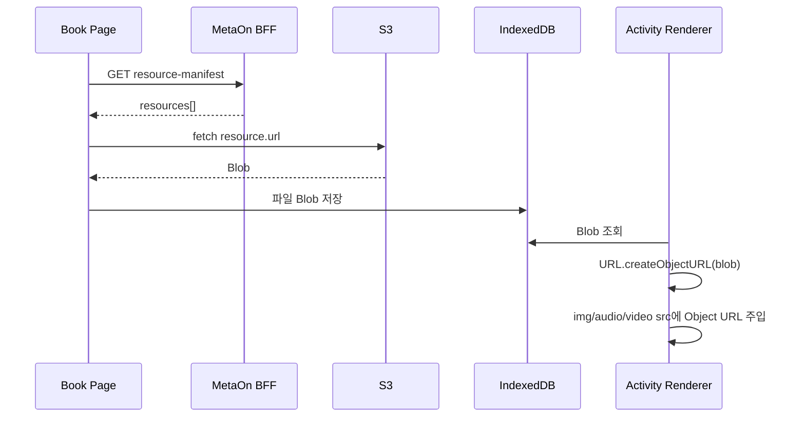
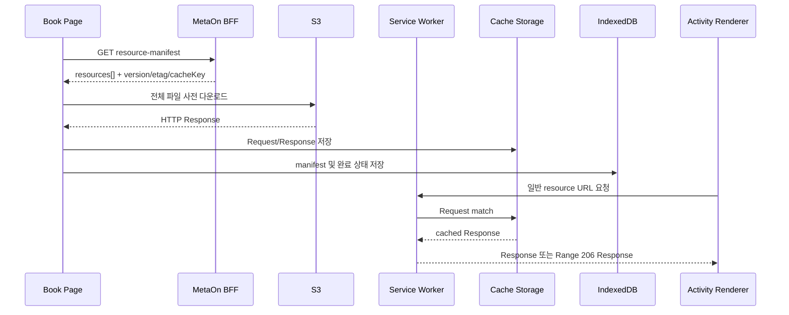

# MetaOn 미디어 캐시 전환 브리핑

작성일: 2026-07-31
대상: MetaOn Webapp, 콘텐츠 API, S3 리소스 운영 담당자

## 1. 목적

MetaOn의 Book 리소스, 특히 동영상형 Activity와 `MOVIE01`의 MP4를 현재의 IndexedDB Blob 저장 방식에서 **Service Worker + Cache Storage** 중심 방식으로 전환한다.

목표는 다음과 같다.

- 동영상이 실행 직전에 Blob으로 다시 만들어지는 지연을 줄인다.
- 브라우저의 표준 `<video>` 재생, 탐색, Range 요청 처리를 그대로 사용한다.
- 한 번 다운로드한 Book의 이미지, 오디오, 자막, 영상을 네트워크 없이 재사용한다.
- 기존 Book 목록, `resource-manifest`, 직접 S3 다운로드, 학습 Activity의 기능을 유지한다.

이 전환은 ZIP 파일 방식으로 되돌아가는 작업이 아니다. S3 직접 다운로드 방식을 유지하면서 브라우저 저장소의 역할을 정리하는 작업이다.

## 2. 현재 구조와 한계

현재 Book 다운로드 흐름은 아래와 같다.



현재 구현은 `indexedDbStorage.savePackage()`에 리소스 Blob 전체를 저장하고, Activity renderer가 `getFileBlob()`과 `URL.createObjectURL()`을 사용한다.

이 방식은 이미지와 JSON에는 동작하지만 MP4에는 다음 문제가 있다.

| 항목 | 현재 IndexedDB Blob 방식 | 영향 |
|---|---|---|
| 재생 시작 | 파일 Blob을 읽고 Object URL을 생성한 후 시작 | 큰 MP4에서 최초 표시가 늦을 수 있음 |
| 메모리 | JS 코드가 Blob과 Object URL 수명 관리 | 태블릿에서 메모리 압박 가능 |
| 탐색 | 브라우저의 HTTP Range 처리 경로를 직접 쓰지 못함 | seek와 재생 안정성이 낮아질 수 있음 |
| 갱신 | 파일별 Blob 비교와 교체를 앱 코드가 처리 | 리소스 버전 관리가 복잡함 |
| 오프라인 | 가능하지만 renderer마다 Blob 처리 필요 | 구현 중복과 오류 가능성 증가 |

IndexedDB 자체가 잘못된 선택은 아니다. IndexedDB는 manifest, 다운로드 상태, 버전, 학습 임시 상태처럼 구조화된 데이터를 보관하는 용도로 계속 사용한다.

## 3. 결정

### 저장소 역할 분리

| 데이터 | 기본 저장소 | 이유 |
|---|---|---|
| MP4, MP3, PNG, JPG, WebP, VTT, SMI, JSON 원본 | Cache Storage | HTTP Request/Response 단위 캐시, Service Worker에서 직접 반환 가능 |
| Book manifest, resource 목록, 다운로드 상태, 오류, 재시도, 캐시 버전, ETag | IndexedDB | Book 단위 조회와 상태 관리에 적합 |
| 생성 JSON (`info_word.json` 등) | Cache Storage 또는 IndexedDB metadata | 작은 파일은 마이그레이션 단계에서 IndexedDB 유지 가능 |
| 학습 이벤트, 답안, 진도 | 서버 API 및 IndexedDB 임시 큐 | 리소스 캐시와 독립 관리 |

### 목표 구조



핵심은 Activity가 Blob URL이 아니라 **고정된 리소스 URL**을 ``, `<audio>`, `<video>`의 `src`로 사용한다는 점이다. Service Worker가 해당 URL의 캐시 응답을 반환한다.

## 4. 적용 범위

### 1차 전환 범위

1. 영상형 Activity: `WDCA02`, `WDQU03`, `WDBL02`, `STBL02`, `STSC02`, `STRC02`
2. `MOVIE01`의 MP4, MP3, 자막, word timing JSON
3. Listening E-book의 페이지 이미지, 오디오, `book.json`

### 2차 전환 범위

1. 일반 Word/Sentence Activity의 이미지와 사운드
2. NPC Quick Check의 스크립트 JSON, 음성, NPC 이미지
3. 모든 Book 리소스의 통합 캐시 관리 화면과 용량 정리 UX

### 이번 전환에서 변경하지 않는 항목

- MetaOn 로그인, 프로필 선택, 학습 결과 API
- Book/Activity 라우팅
- `GET /api/books/:bookIdx/resource-manifest` URL
- S3 직접 다운로드 원칙
- 콘텐츠 원본 경로와 `resources[].path` virtual path 규칙

## 5. 클라이언트 구현 방안

### 5.1 Service Worker

- Vite 기반 앱에 Service Worker를 등록한다.
- App shell은 별도 정적 cache로 관리한다.
- Book 리소스 cache 이름은 `metaon-book-media-v{schemaVersion}` 형식을 사용한다.
- Book 리소스는 manifest가 내려준 `cacheKey`와 `resourceVersion`을 기준으로 Cache Storage에 저장한다.
- 미디어 요청은 Cache First, cache miss 시 네트워크 fallback으로 처리한다.
- `<video>`와 `<audio>`는 `crossorigin="anonymous"`를 명시한다.
- MP4/MP3 요청은 Range 요청을 206 응답으로 반환하도록 Workbox `RangeRequestsPlugin` 또는 동등한 구현을 적용한다.

동영상은 브라우저가 첫 재생 시 부분 Range 요청을 보낼 수 있다. 따라서 전체 파일을 미리 Cache Storage에 넣고, Service Worker가 Range 요청을 처리해야 안정적인 오프라인 재생과 탐색이 가능하다.

### 5.2 Downloader

Book 페이지 진입 시 현재처럼 manifest를 수신한다. 다만 파일별 `response.blob()`을 IndexedDB에 저장하지 않고, 전체 `Response`를 Cache Storage에 저장한다.

다운로드 UI는 다음 상태를 표시한다.

- `preparing`: manifest 확인
- `downloading`: 파일 수, 바이트, 현재 카테고리
- `saving`: Cache Storage 기록 및 IndexedDB metadata 기록
- `ready`: 즉시 Activity 실행 가능
- `partial`: 선택 리소스 실패, 재시도 필요
- `stale`: version/etag 변경으로 재다운로드 필요

다운로드는 동시성 제한을 둔다. 기본값은 3개이며 태블릿 네트워크 상태에 따라 조정 가능하게 한다.

### 5.3 IndexedDB metadata 예시

```ts
type CachedBookResourceState = {
  bookIdx: number;
  cacheSchemaVersion: number;
  resourceManifestVersion: string;
  cacheName: string;
  downloadedAt: string;
  totalFiles: number;
  totalBytes: number;
  complete: boolean;
  resources: Array<{
    path: string;
    cacheKey: string;
    version: string;
    etag?: string;
    size?: number;
    mimeType: string;
    status: "cached" | "failed" | "skipped";
    error?: string;
  }>;
};
```

### 5.4 기존 캐시 호환

- 기존 IndexedDB Blob cache는 즉시 삭제하지 않는다.
- 새 cache schema 버전이 없는 기존 Book은 다음 다운로드 시 Service Worker 방식으로 다시 저장한다.
- Service Worker cache miss 시, 전환 기간에는 기존 IndexedDB Blob을 임시 fallback으로 사용할 수 있다.
- 안정화가 끝나면 Blob fallback을 제거하고 IndexedDB의 대용량 `files` store를 정리한다.

## 6. 캐시 키와 버전 규칙

### 원칙

1. S3 URL의 서명 쿼리 문자열은 cache identity로 사용하지 않는다.
2. `cacheKey`는 Book/리소스/버전을 포함한 안정적인 논리 키여야 한다.
3. 파일 내용이 바뀌면 `version`, `etag`, 또는 `sha256` 중 하나가 반드시 바뀌어야 한다.
4. 같은 virtual path에 다른 콘텐츠를 무단 덮어쓰지 않는다.

예시:

```text
cacheKey: metaon/book/6710/v20260731/Books/6710/ebook/assets/audio/p001.mp3
virtualPath: Books/6710/ebook/assets/audio/p001.mp3
```

## 7. 운영 및 UX 기준

- 첫 다운로드는 현재보다 빨라지는 기능이 아니라, 이후 재실행과 오프라인 재생을 안정화하는 기능이다.
- Book 진입 즉시 현재 Activity에 필요한 최소 리소스를 우선 저장하고, 나머지는 다음 페이지/다음 Activity 순으로 prefetch한다.
- 사용자가 명시적으로 Book 전체를 받는 경우에만 전체 리소스를 사전 저장한다.
- 저장 공간이 부족하면 가장 오래 사용하지 않은 완료 Book cache부터 삭제한다. 현재 열려 있는 Book과 진행 중인 다운로드는 삭제 대상에서 제외한다.
- `navigator.storage.persist()` 요청은 사용자 동작 이후에만 시도하며, 거부되어도 정상 동작해야 한다.

## 8. 주요 위험과 대응

| 위험 | 대응 |
|---|---|
| Service Worker 업데이트 후 이전 캐시가 남음 | cache schema/version을 분리하고 activation 시 명시적으로 정리 |
| MP4 Range 요청이 실패함 | Workbox Range 요청 처리, S3 `Accept-Ranges: bytes` 검증 |
| S3 signed URL 만료 | `cacheKey`와 다운로드 URL 분리, manifest 재요청/URL refresh 지원 |
| CORS로 media가 재생되지 않음 | S3 CORS, media `crossorigin`, 노출 헤더를 배포 전 검증 |
| 브라우저 저장 공간 부족 | 용량 표시, LRU 정리, 부분 다운로드/재시도 |
| 캐시만 있고 metadata가 없음 | Cache Storage scan 또는 manifest 재수신 후 복구 |

## 9. 단계별 일정 제안

| 단계 | 작업 | 완료 기준 |
|---|---|---|
| A | manifest 확장 및 S3 헤더 검증 | `cacheKey/version/etag/size` 수신, Range/CORS 확인 |
| B | Service Worker와 Cache Storage downloader | MP4 1개를 캐시 후 새로고침 재생 |
| C | MOVIE01, 동영상형 Activity 적용 | 동영상 배경과 Movie 모드가 cache에서 재생 |
| D | E-book 적용 | 페이지 이미지/오디오/JSON이 캐시에서 동작 |
| E | 전체 Book 리소스 전환 및 정리 UX | IndexedDB Blob fallback 제거 기준 확정 |

## 10. 검증 기준

1. 최초 다운로드 후 네트워크를 끈 상태에서 동일 Book의 MP4가 재생된다.
2. 영상 재생 중 seek를 수행해도 멈추지 않는다.
3. 새로고침 후 `URL.createObjectURL()` 없이 동일 resource URL로 재생된다.
4. manifest version이 변경되면 이전 cache를 사용하지 않고 새 리소스를 받는다.
5. S3에서 `GET`, `HEAD`, single-range `GET`이 모두 정상 응답한다.
6. 태블릿 Chrome/WebView와 데스크톱 Chrome에서 동일하게 재생된다.

## 11. 참고

- Cache Storage는 Service Worker 또는 window에서 접근하는 Request/Response cache이다. [MDN CacheStorage](https://developer.mozilla.org/en-US/docs/Web/API/CacheStorage)
- IndexedDB는 manifest와 상태 같은 구조화된 대용량 데이터를 위한 저장소로 유지한다. [MDN IndexedDB](https://developer.mozilla.org/en-US/docs/Web/API/IndexedDB_API)
- 캐시된 audio/video를 제공할 때는 사전 cache와 Range 요청 처리가 필요하다. [Chrome Workbox media caching](https://developer.chrome.com/docs/workbox/serving-cached-audio-and-video/)
